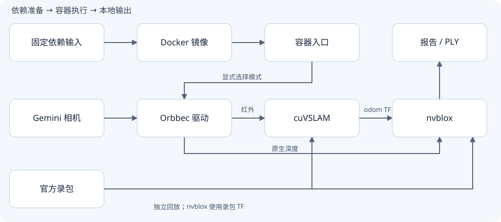

<div align="center">
<h1>Gemini Isaac ROS Workbench</h1>
<p>在 Docker 社区版中测试 Orbbec Gemini 相机、GPU 视觉定位与实时三维建图。</p>

[English](README.md) · [简体中文](README-zh.md)

[特性](#features) · [架构](#architecture) · [快速开始](#quick-start) · [文档](#documentation)
</div>

<a id="features"></a>
## 1. 特性

- 无相机也能开始：检查真实 CUDA 计算，并回放 NVIDIA 官方 VSLAM / nvblox 数据。
- 连接相机后检查彩色、左右红外、原生深度和 IMU；双目图像用于视觉定位，深度用于几何建图。
- 浏览器实时显示三维表面、真实 ESDF 彩虹距离场、RGB/深度预览、相机轨迹和数据年龄；正常停止前尝试导出 PLY。
- ROS、CUDA 开发依赖和相机驱动留在容器内，沿用宿主已有 NVIDIA 驱动及 Docker 存储配置。

**实机参考设备是 Gemini 335L。** 336L 使用同系列候选配置，仍需核对设备 profile 并完成实机验证。当前关闭投射器，不融合 IMU 或 RGB 颜色；输出是相机位姿、几何网格和距离场，不包含完整导航、控制或计量精度保证。

## 2. 组件与职责

<table>
<thead><tr><th scope="col">组件</th><th scope="col" width="10000">职责</th></tr></thead>
<tbody>
<tr><td nowrap><a href="scripts/prepare.py">输入准备</a></td><td>下载固定版本输入、校验 SHA-256，保留已修改的驱动源码。</td></tr>
<tr><td nowrap><a href="docker/">容器镜像</a></td><td>核心算法镜像和包含 Orbbec 驱动的相机镜像。</td></tr>
<tr><td nowrap><a href="scripts/live.sh">实机入口</a></td><td>出流、定位、建图和实时查看器的启动与停止。</td></tr>
<tr><td nowrap><a href="viewer/live.html">实时查看</a></td><td>容器内 ROS 经管道传至宿主回环服务，在浏览器更新地图、距离场、双图像与轨迹。</td></tr>
<tr><td nowrap><a href="docs/DEVELOPMENT-zh.md">验证入口</a></td><td>GPU、官方录包、禁用相机的组件检查及本地软件回归。</td></tr>
</tbody>
</table>

<a id="architecture"></a>
## 3. 架构与流程



左右 IR 和 CameraInfo → cuVSLAM 相机位姿/TF；原生深度和 `odom` TF → nvblox 网格/ESDF。实时查看器接收增量网格、ESDF、RGB/深度及里程计，在宿主 `127.0.0.1:8770` 提供只读页面，容器运行时仍不连接网络。官方两套录包检查相互独立，nvblox 录包自带位姿/TF。

[架构说明](docs/ARCHITECTURE-zh.md) · [离线交互源码地图](docs/architecture/index.html) · [可编辑模型](docs/architecture/architecture.json)

交互源码地图介绍项目结构，克隆后直接打开 HTML；它与实时建图页面不同。GitHub 的 HTML 链接只展示源码。

## 4. 安装

先准备 Ubuntu 24.04 x86_64、Git、Python 3.12+、`dpkg-deb`、Docker Engine Community，以及已配置的 NVIDIA Container Toolkit 和兼容容器 CUDA 13.2 的 NVIDIA 驱动。宿主不需要安装 ROS。查看器需要支持 WebGL 2 的浏览器。

首次构建和下载需要访问 NVIDIA、NGC 与 GitHub。全新构建并准备两套数据建议预留约 80 GB；只测试 GPU 或相机时可以不下载大录包。默认实机容器资源上限为 20 GiB 内存、12 CPU 和 2 GiB `/dev/shm`，运行前应确认主机资源充足。

```bash
git clone https://github.com/xensexyq/gemini-isaac-ros-workbench.git
cd gemini-isaac-ros-workbench
./scripts/build_image.sh
```

脚本不安装宿主驱动、udev 规则、软件源或 Docker 服务，也不迁移 Docker 镜像层。固定输入与 APT 版本解析的复现边界、参考硬件及存储要求见[安装指南](docs/INSTALL-zh.md)。

<a id="quick-start"></a>
## 5. 快速开始

### 5.1 没有相机：先验证 GPU 和官方数据

```bash
./scripts/validate_environment.sh gpu
python3 scripts/prepare.py visual_slam
./scripts/validate_environment.sh vslam
```

第一条执行真实 CUDA 内核；后两条下载并回放官方双目录包。日志和结果保存在 `runs/`。需要验证 nvblox 官方录包时，按[复现步骤](docs/REPRODUCE-zh.md)准备可选数据。

### 5.2 连接相机：实时建图

通过 USB 3 连接一台相机，确认 `lsusb -t` 显示 `5000M` 或更高，并关闭其他占用该相机的采集程序。

```bash
./scripts/build_camera_image.sh
./scripts/validate_camera_setup.sh
./scripts/live.sh doctor
./scripts/live.sh start
./scripts/live.sh visualize
```

打开 **http://127.0.0.1:8770/**。等待“实时更新中”后，缓慢平移/转动相机，保持有纹理、静止且相互重叠的视野。多相机时使用 `./scripts/live.sh visualize <目标序列号>`。首次建议先用 `./scripts/live.sh camera` 检查出流，按 Ctrl+C 停止后再运行 `visualize`。

结束时在启动终端按 Ctrl+C，或在另一个终端执行：

```bash
./scripts/live.sh visualize-stop
./scripts/live.sh stop
```

正常停止会尝试保存 `runs/<时间>-live-view/reports/live-mesh.ply`，通过 `bridge-summary.json` 中的 `ply_export_success` 确认结果。实时页面与之前导出的离线地图不同；停止或数据过期会明确标记。更多出流、录包和排障步骤见[相机指南](docs/CAMERA-zh.md)。

<a id="documentation"></a>
## 6. 文档

- [复现步骤](docs/REPRODUCE-zh.md)：按阶段执行、预期结果、停止与常见故障。
- [安装指南](docs/INSTALL-zh.md)：环境、参考硬件、固定输入、下载与存储。
- [相机操作](docs/CAMERA-zh.md)：profile、话题、实时查看、录包和地图导出。
- [架构说明](docs/ARCHITECTURE-zh.md)：进程边界、数据流、对象生命周期与失败处理。
- [维护指南](docs/DEVELOPMENT-zh.md)：软件检查、容器检查和架构地图维护。

## 7. 致谢与许可

项目参考 [orbbec/isaac_ros-dev](https://github.com/orbbec/isaac_ros-dev)，使用 [NVIDIA Isaac ROS](https://nvidia-isaac-ros.github.io/) 和 [OrbbecSDK_ROS2](https://github.com/orbbec/OrbbecSDK_ROS2)，属于独立集成项目。

本项目暂未为自有代码授予统一许可。第三方组件保留其原有许可证，见 [NOTICE](NOTICE) 与保留的 [Apache-2.0 文本](LICENSES/Apache-2.0.txt)。容器镜像、SDK 二进制和数据集从上游下载，不在本仓库重新分发。
