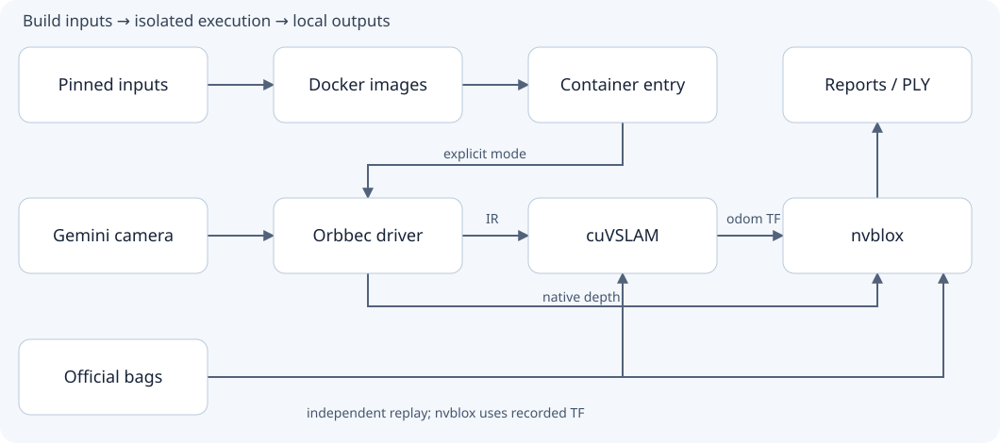

<div align="center">
<h1>Gemini Isaac ROS Workbench</h1>
<p>Test Orbbec Gemini cameras, GPU visual localization and live 3D mapping in Docker Community.</p>

[English](README.md) · [简体中文](README-zh.md)

[Features](#features) · [Architecture](#architecture) · [Quick start](#quick-start) · [Documentation](#documentation)
</div>

<a id="features"></a>
## 1. Features

- Start without a camera: check real CUDA computation and replay NVIDIA's official VSLAM / nvblox data.
- Inspect color, stereo IR, native depth and IMU from a connected camera; stereo images drive localization and depth drives geometry reconstruction.
- View 3D surfaces, real rainbow ESDF distance fields, RGB/depth previews, camera trajectories and data age in a browser; attempt PLY export before normal shutdown.
- Keep ROS, CUDA development packages and camera drivers inside the container, using the host's existing NVIDIA driver and Docker storage configuration.

**Gemini 335L is the hardware reference.** The 336L uses a candidate configuration for the same family and still needs profile checks and hardware validation. The baseline disables the projector and does not fuse IMU or RGB color. Outputs are camera pose, geometry and distance fields; complete navigation, control and metrology accuracy are outside its scope.

## 2. Components

<table>
<thead><tr><th scope="col">Component</th><th scope="col" width="10000">Responsibility</th></tr></thead>
<tbody>
<tr><td nowrap><a href="scripts/prepare.py">Input prep</a></td><td>Download pinned inputs, verify SHA-256 and preserve modified driver sources.</td></tr>
<tr><td nowrap><a href="docker/">Images</a></td><td>Core algorithm image and camera image containing the Orbbec driver.</td></tr>
<tr><td nowrap><a href="scripts/live.sh">Live entry</a></td><td>Start and stop camera streaming, localization, mapping and visualization.</td></tr>
<tr><td nowrap><a href="viewer/live.html">Live viewer</a></td><td>Relay container ROS data over a pipe to a host loopback service for browser updates.</td></tr>
<tr><td nowrap><a href="docs/DEVELOPMENT.md">Checks</a></td><td>GPU, official bags, camera-disabled component startup and local software regression.</td></tr>
</tbody>
</table>

<a id="architecture"></a>
## 3. Architecture



Stereo IR and CameraInfo → cuVSLAM camera pose/TF; native depth and `odom` TF → nvblox mesh/ESDF. The viewer receives incremental meshes, ESDF, RGB/depth and odometry, exposing a read-only page on host `127.0.0.1:8770` while the runtime container remains offline. The two official replay checks are independent; the nvblox bag provides its own poses/TF.

[Architecture guide](docs/ARCHITECTURE.md) · [Offline source map](docs/architecture/index.html) · [Editable model](docs/architecture/architecture.json)

The source map explains the implementation and opens directly after cloning. It is separate from the live mapping page; GitHub's HTML links display source. The interactive architecture interface is in Chinese.

## 4. Installation

Prepare Ubuntu 24.04 x86_64, Git, Python 3.12+, `dpkg-deb`, Docker Engine Community, NVIDIA Container Toolkit and an NVIDIA driver compatible with the container's CUDA 13.2 runtime. Host ROS is unnecessary. The viewer needs a WebGL 2 browser.

Initial builds/downloads require access to NVIDIA, NGC and GitHub. Reserve around 80 GB for a fresh build and both datasets; GPU/camera-only checks can omit large bags. The live container defaults to limits of 20 GiB RAM, 12 CPUs and 2 GiB `/dev/shm`; check host resources before running.

```bash
git clone https://github.com/xensexyq/gemini-isaac-ros-workbench.git
cd gemini-isaac-ros-workbench
./scripts/build_image.sh
```

Scripts do not install host drivers, udev rules, package sources or the Docker service, or migrate image layers. See [installation](docs/INSTALL.md) for reference hardware, storage, pinned inputs and the reproducibility limits of APT resolution.

<a id="quick-start"></a>
## 5. Quick start

### 5.1 No camera: GPU and official data

```bash
./scripts/validate_environment.sh gpu
python3 scripts/prepare.py visual_slam
./scripts/validate_environment.sh vslam
```

The first command executes a CUDA kernel; the remaining commands download and replay an official stereo bag. Reports and logs remain under `runs/`. For the optional nvblox bag, follow the [reproduction guide](docs/REPRODUCE.md).

### 5.2 Camera: live mapping

Connect one camera over USB 3, check for `5000M` or higher in `lsusb -t`, and close other programs capturing from that camera.

```bash
./scripts/build_camera_image.sh
./scripts/validate_camera_setup.sh
./scripts/live.sh doctor
./scripts/live.sh start
./scripts/live.sh visualize
```

Open **http://127.0.0.1:8770/**. Wait for the live status, then slowly translate/rotate the camera through overlapping views of fixed, textured objects. With multiple cameras, use `./scripts/live.sh visualize <target-serial>`. On first connection, inspect streams using `./scripts/live.sh camera`, then stop it with Ctrl+C before `visualize`.

Finish with Ctrl+C in the launching terminal, or from another terminal:

```bash
./scripts/live.sh visualize-stop
./scripts/live.sh stop
```

Normal shutdown attempts to save `runs/<timestamp>-live-view/reports/live-mesh.ply`. Confirm `ply_export_success` in `bridge-summary.json`. The live page differs from an exported offline map and explicitly marks stopped/stale data. See the [camera guide](docs/CAMERA.md) for topics, recording and troubleshooting.

<a id="documentation"></a>
## 6. Documentation

- [Reproduction guide](docs/REPRODUCE.md): ordered stages, expected outputs, stopping and common failures.
- [Installation](docs/INSTALL.md): environment, reference hardware, pinned inputs, downloads and storage.
- [Camera operation](docs/CAMERA.md): profiles, topics, live visualization, recording and export.
- [Architecture](docs/ARCHITECTURE.md): process boundaries, data paths, object lifetimes and failures.
- [Maintenance](docs/DEVELOPMENT.md): software checks, container checks and architecture-map maintenance.

## 7. Attribution and licensing

Inspired by [orbbec/isaac_ros-dev](https://github.com/orbbec/isaac_ros-dev), using [NVIDIA Isaac ROS](https://nvidia-isaac-ros.github.io/) and [OrbbecSDK_ROS2](https://github.com/orbbec/OrbbecSDK_ROS2). This is an independent integration project.

Project-authored code does not currently have a blanket license grant. Third-party components retain their own licenses; see [NOTICE](NOTICE) and the preserved [Apache-2.0 text](LICENSES/Apache-2.0.txt). Container images, SDK binaries and datasets are downloaded from upstream rather than redistributed here.
